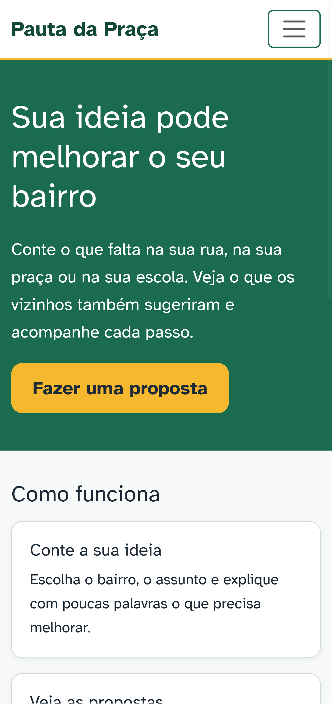
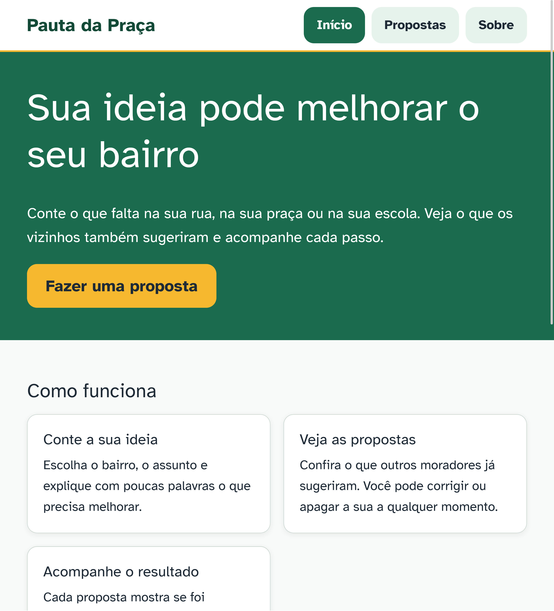
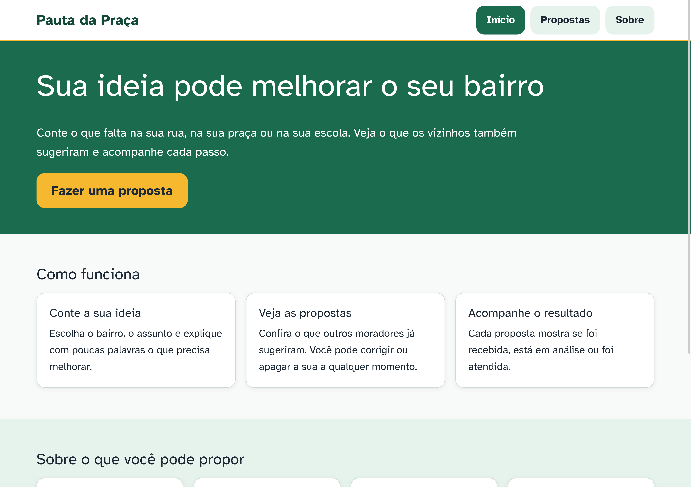

# Pauta da Praça

> Sua ideia pode melhorar o seu bairro.

Protótipo funcional de uma solução de **Tecnologia Cidadã**, criado para a disciplina **Desenvolvimento Web I** (curso de Desenvolvimento de Software Multiplataforma, FATEC Luigi Papaiz).

A Pauta da Praça é um site onde moradores propõem melhorias para o bairro, veem o que os vizinhos sugeriram e acompanham o andamento de cada proposta.

> **Aviso:** é um protótipo acadêmico. Use apenas dados fictícios.

---

## 1. Da vida real ao site

**Tema escolhido:** Serviços públicos e participação cidadã.

| Pergunta | Resposta |
| --- | --- |
| **Quem é o cidadão afetado?** | Moradores de bairros que querem opinar sobre melhorias locais (iluminação, praças, calçadas, transporte), principalmente jovens, idosos e moradores de municípios pequenos. |
| **Qual é o problema?** | A participação existe na lei, mas é difícil de acessar. Falta um lugar simples para propor ideias, ver as de outros moradores e saber se alguém as recebeu. |
| **Que evidência comprova?** | Observa-se que a população dos bairros muitas vezes não possui espaços efetivos para expressar suas necessidades e participar das decisões sobre o planejamento urbano. Problemas como falta de iluminação pública, calçadas inadequadas, ausência de áreas de lazer e dificuldades de mobilidade são vivenciados diariamente pelos moradores, mas nem sempre chegam ao conhecimento do poder público. Dessa forma, a comunidade acaba tendo pouca voz nas decisões que afetam diretamente seu cotidiano, reforçando a importância de conselhos municipais e de outros mecanismos de participação popular. |
| **ODS relacionados** | ODS 9 (inovação), ODS 10 (redução das desigualdades) e ODS 11 (cidades e comunidades sustentáveis). |

### Como se sustentaria como negócio de impacto
- **Prefeituras e câmaras municipais** pagam uma assinatura por um painel que organiza as propostas por bairro, assunto e status.
- **Moradores e associações de bairro** usam gratuitamente.
- **Escala:** o mesmo sistema atende qualquer cidade, trocando apenas a lista de bairros.
- **Receita complementar:** relatórios agregados e anônimos para pesquisadores, ONGs e imprensa.

---

## 2. Funcionalidades

- Enviar uma proposta (bairro, assunto, título e explicação), com apelido opcional.
- CRUD: adicionar, listar, editar e remover propostas, atualizando a página pelo DOM.
- Validação nativa do HTML5 e validação em JavaScript, com mensagens na tela embaixo de cada campo.
- Painel de registro de atividades com: data/hora, ação e resultado de cada operação.
- Dados guardados no LocalStorage.

---

## 3. Tecnologias

- HTML5
- CSS3
- JavaScript
- Bootstrap 5 (via CDN): navbar, grid, cards, formulário, botões e alertas
- Git e GitHub

---

## 4. Estrutura do projeto

```
pauta-da-praca/
├── index.html            # página inicial
├── pages/
│   ├── propostas.html    # formulário, lista de propostas e painel de atividades
│   └── sobre.html        # sobre o projeto, privacidade e ODS
├── css/
│   └── global.css        # estilos próprios, carregados depois do Bootstrap
├── script/
│   ├── validacao.js      # regras de validação dos dados
│   ├── atividades.js     # painel de registro de atividades
│   └── propostas.js      # adicionar, listar, editar e remover
├── assets/               # imagens e ícones
└── README.md
```

---

## 5. Como executar

1. Baixe ou clone o repositório:
   ```
   git clone https://github.com/gabrielc-freire/Pauta-da-Praca.git
   ```
2. Abra o arquivo `index.html` no navegador (é preciso internet para carregar o Bootstrap e a fonte).

---

## 6. Segurança e privacidade

**Validação de toda entrada**: campo vazio, tamanho mínimo e máximo, formato e tipo. Bairro e assunto só aceitam valores da lista.

**Mensagens de erro sem detalhes internos:** o usuário vê "Não foi possível carregar os dados. Tente novamente." O erro técnico vai apenas para o `console`.

**Coleta mínima de dados:** só bairro, assunto, título e explicação. O apelido é opcional. O formulário traz um aviso de privacidade, e o sistema recusa textos com números longos (como telefone ou CPF).

---

## 7. Telas do site



